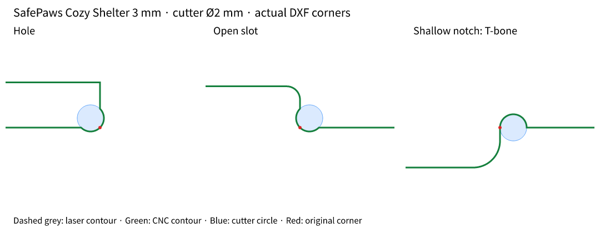

> Исторический отчёт предыдущей итерации. Актуальное исправление и повторная проверка: [комбинированная обработка](combined-cutouts/REPORT.ru.md).

# Проверка и исправление DogBone

Дата: 30 октября 2026. Репозиторий: https://github.com/kkrugley/dogbone. Проверенная исходная версия: `6586a77`.

## Результат

Исправление реализовано в локальной копии проекта. На трёх исходных листах SafePaws при диаметре фрезы **2 мм** получено **675 корректно экспортированных вырезов**: 650 dogbone и 25 T-bone. Все 150 контуров слоя резки остаются замкнутыми; исходные дуги, окружности и названия слоёв сохраняются. Повторный импорт обработанных файлов не создаёт дополнительные вырезы.

Это проверка цифровой геометрии и работы приложения. Физическая фрезеровка, CAM-симуляция и сборка домика не выполнялись. Изменения не опубликованы в GitHub и не развёрнуты на production.

## Исходные чертежи

Файлы скачаны по ссылкам, опубликованным на https://safepaws.ru/download:

| Домик | Архив | Лист внутри архива |
|---|---|---|
| Cozy Shelter, фанера 3 мм | [SafePawsCozyShelter_3mm.zip](https://safepaws.ru/files/SafePawsCozyShelter_3mm.zip) | `Parts-Ready-to-cut/DXF/Sheet_1.dxf` |
| Cozy Shelter, фанера 6 мм | [SafePawsCozyShelter_6mm.zip](https://safepaws.ru/files/SafePawsCozyShelter_6mm.zip) | `1500x750/1500x750-1.dxf` |
| Family Shelter, фанера 6 мм | [SafePawsFamilyShelter_6mm.zip](https://safepaws.ru/files/SafePawsFamilyShelter_6mm.zip) | `1500x750/1500X750-1.dxf` |

Это настоящие исходные DXF, содержащие соответственно 1 272, 9 742 и 16 166 сущностей. Контрольные копии находятся в `tests/fixtures/safepaws/`, ссылки и SHA-256 — в `sources.json` рядом с ними. Проверены эти три листа, а не все детали из архивов.

Настройки: диаметр 2 мм, допуск соединения 0,01 мм, исключённые из обработки слои `mark` и `text`, фильтр больших отверстий включён, порог 30 мм. Координаты исходных файлов интерпретируются как миллиметры.

## Почему исходная версия ошибалась

1. **Выбирала выпуклые углы каждого контура.** Алгоритм учитывал направление обхода, но не вложенность. У отверстия нужны выпуклые углы его внутренней области; у внешней границы детали нужны вогнутые углы — основания открытых пазов. Исходная версия их пропускала.
2. **Фильтр габаритов исключал большие детали целиком.** Вместе с ними исчезали основания пазов на стенках и крыше. Теперь фильтр применяется к большим отверстиям; внешние детали остаются доступными для обработки.
3. **Сборщик цепочек продолжал поиск с устаревшими концами.** После добавления сегмента концы цепочки не обновлялись до следующего прохода. Также поиск не разделял слои, использовал жёстко заданные 0,5 мм и заменял слой на `default`. На Cozy 3 мм получались 145 контуров вместо 139.
4. **Полилинии теряли замкнутость и дуги.** Флаг `shape` и `bulge` не учитывались. Индексы соседних рёбер в проверке углов были смещены. При изменении смешанного контура экспорт мог заменить его исходные дуги хордами.
5. **Короткие уступы молча оставались без выреза.** Если окружность не пересекала оба конечных отрезка, экспорт пропускал вырез. Например, в исходной версии Family счётчик показывал 45 вырезов, а в геометрию попадали только 40.
6. **Исключение слоёв зависело от регистра.** `Mark` из Family не совпадал с `mark` из настроек.

## Выбор решения

| Вариант | Оценка |
|---|---|
| Изменить только знак определения угла | Быстро, но ломает прямоугольные отверстия и не исправляет импорт/экспорт. |
| Заменить обработку целиком булевыми операциями над полигонами | Подходит для сложных пересечений, но потребует согласованной модели материала и аппроксимации исходных дуг либо другого геометрического ядра. |
| **Классификация вложенности + локальные точные дуги** | **Выбрано:** устраняет причины ошибок, сохраняет исходные дуги DXF и не требует нового ядра. |

Реализация определяет отверстия по чётности вложенности независимо от направления обхода. Для внешней детали выбираются вогнутые прямые углы, для отверстия — выпуклые. Окружность dogbone имеет радиус фрезы, её центр смещён на этот радиус в свободную область по биссектрисе. В контур вставляется дуга, удаляющая материал у исходного угла.

Когда короткая стенка не позволяет построить обычный dogbone, используется **T-bone** вдоль длинной стенки: окружность касается короткой стенки в исходном углу. Если вырезы соседних углов перекрывают общий прямой участок или инструмент не помещается, такие вырезы отклоняются с предупреждением в Report.

Предпросмотр строится по той же геометрии, что и экспорт. В DXF используются точные дуги LWPOLYLINE (`bulge`), а не набор коротких прямых. Сборщик пересчитывает концы после каждого добавления, сохраняет слой и использует заданный допуск. Импорт поддерживает замкнутые полилинии и их дуги; `Mark` исключается независимо от регистра.



## Сравнение до и после

«Добавлено в DXF» подсчитано по фактически вставленным дугам, отдельно от счётчика интерфейса.

| Лист | До: счётчик / добавлено в DXF | После: счётчик / добавлено в DXF | T-bone | Исходные дуги → дуги в результате |
|---|---:|---:|---:|---:|
| Cozy 3 мм | 188 / 188 | **310 / 310** | 20 | 124 → 434 |
| Cozy 6 мм | 188 / 188 | **262 / 262** | 2 | 78 → 340 |
| Family 6 мм | 45 / 40 | **103 / 103** | 3 | 86 → 189 |

Большее число вырезов само по себе не служило критерием правильности: отдельно проверялись сторона удаления материала, отсутствие обработки внешних выпуклых углов, радиус каждой новой дуги, сохранение исходных дуг и повторный импорт.

## Проверка интерфейса

Сценарии выполнены в Chromium, управляемом через Playwright; снимки экрана и увеличенные фрагменты просмотрены визуально. Исходная и исправленная версии запускались локально из раздельных checkout. Это не проверка развёрнутого публичного экземпляра.

| Сценарий | Результат |
|---|---|
| Загрузить Cozy 3 мм; открыть детальный вид и Report | 139 контуров, 310 вырезов; ошибок JavaScript нет. |
| Увеличить чертёж колёсиком | Предпросмотр показывает дуги и вырезы. |
| Отключить один вырез, скачать DXF | Число дуг уменьшается с 434 до 433. |
| Вернуть вырез, сменить диаметр на 4 мм, нажать Apply & Re-process | 118 допустимых вырезов; Report предупреждает о неподходящих углах. |
| Вернуть диаметр 2 мм и повторно обработать | Снова 310 вырезов, в скачанном файле 434 дуги. |
| Загрузить скачанный DXF заново | 0 новых вырезов; обработанные дуги сохранены. |
| Одновременно загрузить три файла, Export All (ZIP) | ZIP содержит три читаемых DXF с 434, 340 и 189 дугами. |

Полный журнал: [browser-checks.json](browser-checks.json). Скриншоты: [до](before-detail.png), [после](after-detail.png), [отчёт интерфейса](processing-report.png), [пакетная загрузка](after-batch.png).

В Cozy 3 мм интерфейс показывает 43 незамкнутых контура: это разметка слоя `mark`. Все 63 контура слоя `cut` замкнуты. Предупреждения общего отчёта о коротких контурах включают окружности и элементы разметки и сами по себе не означают повреждение реза.

## Автоматическая проверка

- `npm ci` проходит. Исправлен исходный рассинхрон `package-lock.json`, из-за которого чистая установка завершалась ошибкой.
- `npm test`: **34/34**. Добавлены 11 регрессионных сценариев, включая три реальных файла SafePaws.
- Проверены оба направления обхода, вложенный остров, отверстия, открытые пазы, T-bone, слишком большая фреза, дуговые стыки, разные слои, замкнутые полилинии и повторный импорт.
- Для каждого сгенерированного выреза проверен радиус **1 мм** и факт вставки в контур.
- Независимая проверка Shapely 2.2.0: **139 полигонов слоя резки без самопересечений**. Для этой проверки дуги дискретизированы; DXF хранит их точно. Остальные 11 замкнутых контуров — окружности, их число сохранено.
- `npm run build` проходит. `npm run lint` завершается без ошибок; остаются четыре прежних предупреждения в UI-примитивах и генераторе OG-картинки. Сборщик также предупреждает о крупном JS-бандле.

Для воспроизведения из корня проекта:

```sh
npm ci
npm test
npm run lint
npm run build
npm run dev
```

## Готовые файлы и границы результата

Исправленные листы под фрезу **Ø2 мм**:

- [Cozy Shelter 3 мм](cozy-3mm-sheet-1-cnc.dxf)
- [Cozy Shelter 6 мм](cozy-6mm-sheet-1-cnc.dxf)
- [Family Shelter 6 мм](family-6mm-sheet-1-cnc.dxf)

Толщина фанеры не равна диаметру инструмента: для другой фрезы нужно повторить обработку с её диаметром. Для 3-мм пазов фреза 4 мм непригодна; предупреждение нельзя считать подтверждением готовности такого файла к изготовлению.

Автопоиск ориентирован на прямые углы между прямыми рёбрами с существующим допуском около ±5,7°. Поддержаны LINE, ARC, CIRCLE, POLYLINE и LWPOLYLINE; SPLINE, INSERT и произвольные повреждённые/самопересекающиеся входные чертежи этой работой не покрыты. Проверка не заменяет назначение внутренней/внешней компенсации инструмента и траекторий в CAM. Прочность оставшихся перемычек и сборочные зазоры требуют проверки для выбранного материала и станка.
